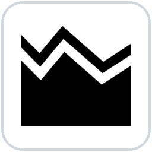

# User Tutorial

[Documentation Home](README.md) · [Installation Guide](installation.md) · [References](references.md)

This tutorial covers configuring CarbonXS parameters and diffractometer settings, loading experimental XRD patterns, running single calculations and least-squares refinements, interpreting plots and fit diagnostics, and exporting results.

For the mathematical formulation of the scattering model and original parameter definitions, see the included [CarbonXS Manual (PDF)](manual.pdf).

---

## Table of Contents

1. [Overview of the Workflow](#overview-of-the-workflow)
2. [Configuring Parameters & Settings](#configuring-parameters--settings)
   - [Fitting Parameters (18 Model Parameters)](#fitting-parameters)
   - [Fitting Settings](#fitting-settings)
   - [Diffractometer Settings](#diffractometer-settings)
   - [Importing & Exporting Settings](#importing--exporting-settings)
3. [Loading an Experimental XRD Pattern](#loading-an-experimental-xrd-pattern)
4. [Running Calculations and Fits](#running-calculations-and-fits)
   - [Toolbar Controls](#toolbar-controls)
   - [Plot Controls & Live Loss Tracking](#plot-controls--live-loss-tracking)
   - [Fit Results Dialog & Exporting Output](#fit-results-dialog--exporting-output)
5. [Troubleshooting](#troubleshooting)
6. [Keyboard Shortcuts](#keyboard-shortcuts)

---

## Overview of the Workflow

CarbonXS GUI computes and refines XRD patterns directly in Python (`CarbonXSModel` and `CarbonXSFit`):

1. **Load** an experimental powder XRD scan (`2θ` vs. intensity).
2. **Verify Diffractometer & Fitting Settings** (wavelength, slit geometry, $2\theta$ fitting range, 1-layer vs. 2-layer stacking model).
3. **Inspect or set initial guesses** for the 18 structural, scale, and background parameters, checking **Refine** for each parameter you want optimized.
4. **Calculate Pattern** (single forward simulation) to check your starting guess against the data, then click **Perform Fit** to run bounded Poisson-weighted nonlinear least squares (`scipy.optimize.least_squares` with $w_i = 1/\sqrt{\max(Y_i, 1)}$).
5. **Review** the **Fit Results** dialog (updated values, estimated standard deviations, reduced $\chi^2$, and crystallite height $L_c \pm \sigma_{L_c}$) and **Export** the fitted curve and report files.

---

## Configuring Parameters & Settings

### Fitting Parameters

Use the **Select All**, **Deselect All**, **Default Values**, and **Batch Enable/Disable** controls to quickly toggle groups of parameters.

| # | Name | Description | Typical / Physical Constraints |
|---:|---|---|---|
| 1 | `Scale Factor` | Overall multiplicative scale factor applied to calculated intensity. | Unconstrained |
| 2 | `B0` | Constant background term ($B_0$). | Unconstrained |
| 3 | `B1` | Linear background term ($B_1 \cdot s$). | Unconstrained |
| 4 | `B2` | Quadratic background term ($B_2 \cdot s^2$). | Unconstrained |
| 5 | `B3` | Cubic background term ($B_3 \cdot s^3$). | Unconstrained |
| 6 | `B4` | Quartic background term ($B_4 \cdot s^4$). | Unconstrained |
| 7 | `B5` | Low-angle reciprocal background term ($B_5 / s$). | Unconstrained |
| 8 | `A` | In-plane hexagonal lattice constant $a$ (Å). | $a \ge 1.0$ |
| 9 | `d002` | Average interlayer spacing $d_{002}$ (Å). | $d_{002} \ge 1.0$ |
| 10 | `La` | In-plane crystallite coherence length $L_a$ (Å). | $L_a \ge 1.0$ |
| 11 | `M` | Mean number of stacked graphene layers per crystallite. | $M \ge 0.1$ |
| 12 | `SM` | Width $\sigma_M$ of the Gaussian distribution of layer numbers $M$. | $SM \ge 0.0$ |
| 13 | `Dab` | In-plane strain broadening parameter $\delta_{ab}$. | $\delta_{ab} \ge 0.0$ |
| 14 | `Del` | Interplanar spacing strain/fluctuation parameter $\Delta$. | $\Delta \ge 0.0$ |
| 15 | `Pr` | Probability of random (turbostratic) stacking between adjacent layers ($P_r$). | $0 \le P_r < 1$ |
| 16 | `Pt` / `g` | **1-layer model:** Probability of 3R-like registered stacking ($P_t$, used when $P_t < 1$). **2-layer model:** Fraction $g$ of low-strain phase. | $0 \le P_t, g < 1$ |
| 17 | `B` | Isotropic Debye–Waller thermal factor $B$ (Ų). | $B \ge 0.0$ |
| 18 | `PO` | Preferred orientation parameter. | $PO \ge 0.0$ |

> **Note:** When the **2-layer model** is selected, CarbonXS internally rescales $M$, $SM$, $\Delta$, $P_r$, and $P_t/g$ to match the 2-layer convention in the original Fortran code, and automatically rescales refined values back when displaying results and ESDs.

---

### Fitting Settings

- **Theta Min / Theta Max (2θ):** Range of scattering angles included in calculation and fitting.
- **Iterations:** Maximum function evaluation budget (scaled internally for the least-squares solver).
- **Stop Criteria ($\varepsilon$):** Relative convergence tolerance (`ftol` and `xtol`) for the solver.
- **Data Point Multiple (`nskip`):** Downsampling stride (use `1` for every point, or `n > 1` to use every *n*th point for faster exploratory fits).
- **Layers Model:** Choose **1-layer** (turbostratic / disordered carbons) or **2-layer** (more graphitic carbons with 2H/3R stacking).
- **TCI Points ($N_\phi$):** Number of integration steps along the reciprocal-space rod tangent-cylinder intersection.
- **Integration Width ($N_{\text{SG}}$):** Integration width parameter.

---

### Diffractometer Settings

- **Wavelength (Å):** X-ray wavelength $\lambda$ (e.g., `1.5418` Å for Cu $K\alpha$ or `1.54056` Å for Cu $K\alpha_1$).
- **Sample Depth / Sample Width (mm):** Specimen thickness and illuminated width used in instrumental footprint convolution.
- **Goniometer Radius (mm):** Diffractometer radius ($L_0$).
- **Beam Width (mm):** Incident slit beam width.
- **Relative Density:** Packing density factor of the carbon sample ($\le 1.0$).

---

### Importing & Exporting Settings

- **JSON Configuration (`*.json`):** Fitting Parameters, Fitting Settings, and Diffractometer Settings can each be saved and loaded independently as human-readable `.json` files via the **File** menu.
- **Legacy `carbon.inp`:** You can also import and export classic `carbon.inp` files for compatibility with standalone Fortran CarbonXS workflows.

---

## Loading an Experimental XRD Pattern

Use **File → Open Pattern** (or press `Ctrl+O` / `Cmd+O`) to load an XRD data file.

Supported formats:
- **Jade MDI (`.mdi`)**
- **Rigaku RAS (`.ras`)**
- **XY / Generic Delimited Text (`.xy`, `.txt`, `.dat`, `.csv`)** — opens the **Load Text Data** dialog so you can skip header lines and specify a delimiter (whitespace, comma, tab, or custom):

Once loaded, the experimental trace is plotted in the left **Fit Pattern** canvas:

You can zoom, pan, configure axes, and save snapshots using the built-in [Matplotlib Navigation Toolbar](https://matplotlib.org/stable/users/explain/interactive.html#interactive-navigation). Note that there is **no** 3,000-point cap — patterns of any length can be loaded directly.

---

## Running Calculations and Fits

### Toolbar Controls

| Icon | Action | Description |
|---|---|---|
|  | **Calculate Pattern** (`Ctrl+R`) | Evaluates the forward model with the current parameters and plots **Fit** and **Background** against **Source**. |
|  | **Perform Fit** (`Ctrl+Shift+R`) | Runs nonlinear least-squares optimization in a background thread for all checked parameters. |
|  | **Abort** | Cooperatively cancels the active fit thread cleanly after the current function evaluation. |
|  | **Export Last Fit** | Exports the most recent calculation or fit results to files (see below). |
|   | **History Navigation** (`Alt+Left` / `Alt+Right`) | Steps backward and forward through previous parameter sets stored in session history. |

---

### Plot Controls & Live Loss Tracking

During a fit, the right-hand **Fitting Progress** subplot displays the optimization loss ($0.5 \sum r_i^2$) on a logarithmic scale in real time as function evaluations proceed.

Below the plot canvas, you can adjust visualization interactively:
- **Pattern + Last Fit / Last Fit Difference:** Switch between overlaying the observed pattern, fit, and background vs. viewing the residual difference curve (`Observed − Calculated`):

- **Lock Pattern/Fit Y-Axis** / **Lock Pattern/Fit X-Axis:** Keep zoom limits fixed when iterating on parameters or re-running fits.
- **Show Previous Fit:** Overlay the previous fit curve as a dashed reference line for side-by-side comparison.
- **Log Y-Axis:** Toggle the main pattern intensity axis between linear and logarithmic scale (useful for inspecting weak higher-angle $(hk)$ bands alongside the strong $(002)$ peak).

---

### Fit Results Dialog & Exporting Output

When a fit finishes, the updated parameters are highlighted in the table and the **Fit Results** summary dialog opens:

The **Fit Results** dialog displays:
- Convergence **Status**
- **Reduced $\chi^2$** ($\chi^2_{\text{red}}$)
- Crystallite stacking thickness **$L_c \pm \sigma_{L_c}$** (Å), where $L_c = d_{002} \cdot M$ with propagated uncertainty from $d_{002}$, $M$, and their covariance
- A complete 18-parameter comparison table (**Old Value**, **New Value**, **ESD**)
- **Export Results...** button to save the summary and fit outputs directly

Clicking **Export Last Fit** on the toolbar (or **Export Results...**) lets you choose between two export modes:

1. **`Full Export (*.*)`** — writes three files with your chosen base name:
   - `<name>_carbon_out.txt`: Fortran-formatted refinement report including parameters, ESDs, $L_c \pm \sigma_{L_c}$, reduced $\chi^2$, and the full parameter correlation matrix.
   - `<name>_carbon_dat.txt`: Tabular `2theta`, `observed`, and `calculated` intensities.
   - `<name>_carbon.inp`: Refined parameters formatted as a `carbon.inp` file.
2. **`Jade MDI Format (*.mdi)`** — exports only the calculated curve as `<name>.mdi`.

> **Tip:** Automatically generated runtime files (`carbon.dat`, `carbon.inp`, and `carbon.out`) from your latest run are also stored in your OS user data folder under `last_run/` rather than modifying the read-only `carbonxs/` directory.

---

## Troubleshooting

- **Fit fails to converge or hits parameter bounds:** Check that $d_{002}$, $a$, and $L_a$ have realistic initial guesses (e.g., $d_{002} \approx 3.4\text{–}3.8$ Å, $a \approx 2.45$ Å, $L_a \approx 20\text{–}100$ Å) and try refining **Scale** and **Background** (`B0`–`B5`) first before freeing strain and stacking probabilities ($P_r$, $P_t$, $\delta_{ab}$, $\Delta$).
- **Long-running fit with large datasets or wide integration grids:** Increase **Data Point Multiple (`nskip`)** temporarily for rough exploration, or click **Abort** to cancel cleanly and tighten bounds or initial guesses.
- **Unrealistic background extrapolation:** High-order polynomial background terms (`B3`, `B4`) or `B5 / s` can oscillate if unconstrained over a narrow $2\theta$ range. Uncheck higher-order background parameters unless needed.
- **Inspecting warnings or solver details:** Check the console output window or terminal where CarbonXS GUI was launched for status messages and diagnostic tracebacks.

---

## Keyboard Shortcuts

| Action | Windows / Linux | macOS |
|---|---|---|
| Open Documentation | `F1` | `Cmd + ?` |
| Open Experimental Pattern | `Ctrl + O` | `Cmd + O` |
| Calculate Pattern | `Ctrl + R` | `Cmd + R` |
| Perform Fit | `Ctrl + Shift + R` | `Cmd + Shift + R` |
| Load Default Parameters | `Ctrl + D` | `Cmd + D` |
| Undo Parameter Change (Back) | `Alt + Left` | `Cmd + [` |
| Redo Parameter Change (Forward) | `Alt + Right` | `Cmd + ]` |
